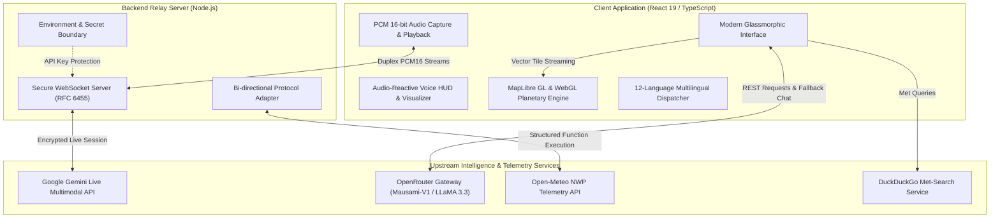

# WeatherGPT

> **Enterprise Meteorological Intelligence, Early Hazard Warning, and Multimodal Conversational Platform**

[](https://react.dev/)
[](https://www.typescriptlang.org/)
[](https://vitejs.dev/)
[](https://tailwindcss.com/)
[](https://websockets.spec.whatwg.org/)
[](LICENSE)

---

## Executive Summary

WeatherGPT is an enterprise-grade meteorological intelligence platform engineered for mission-critical weather forecasting, severe atmospheric hazard detection, agro-climatic advisory synthesis, and low-latency multimodal interaction. 

By unifying high-resolution numerical weather prediction (NWP) telemetry from global and regional observation networks with fine-tuned conversational intelligence (Mausami-V1), WeatherGPT delivers verified forecasts, color-coded civil defense alerts, and real-time interactive geospatial visualizations. The platform is architected to operate under austere connectivity environments through resilient fallback pathways, offline telemetry simulation models, and secure server-side relay brokers.

---

## System Architecture

The following diagram illustrates the end-to-end data flow between the presentation layer, the dedicated Node.js WebSocket relay, and upstream intelligence providers:



---

## Core Capabilities

### 1. Low-Latency Bidirectional Voice AI

- **Full-Duplex Speech-to-Speech**: Native audio streaming using Google Gemini Live WebSocket protocols (`models/gemini-2.5-flash-native-audio-latest`), delivering sub-second voice synthesis without intermediate speech-to-text bottlenecks.
- **Dynamic Mid-Stream Tool Invocation**: The live voice agent autonomously identifies meteorological intents and executes structured functions (`get_live_weather`, `get_weather_alerts`, `get_agro_climate_advisory`) during active voice sessions.
- **Audio-Reactive HUD**: Interactive user interface displaying real-time audio input/output frequency spectra, active state transitions (listening, processing, speaking), and instant barge-in support.
- **Concurrent Streaming Transcription**: Simultaneous real-time transcription of user speech alongside progressive display of synthesized assistant responses.
- **Zero Client Credential Exposure**: All voice transactions route through a standalone Node.js WebSocket relay (`server/relay.mjs`), ensuring sensitive keys remain strictly contained within server memory.

### 2. Meteorological LLM and Domain Guardrails (Mausami-V1)

- **Strict Domain Boundary**: Embedded system prompt constraints that enforce 100% adherence to atmospheric science, disaster preparedness, civil defense protocols, and agricultural intelligence while rejecting off-topic prompt injections.
- **Structured Telemetry Synthesis**: Automated formatting of complex meteorological payloads into high-legibility Markdown tables, covering thermal extremes, wind shear velocities, relative humidity, barometric tendencies, and precipitation probability.
- **Civil Defense Protocol Integration**: Immediate routing of active emergency inquiries to official hotlines (NDMA 1078, state disaster helplines, Indian Coast Guard) paired with actionable, non-speculative safety checklists.
- **Deterministic Offline Simulation**: Seamless failover to deterministic meteorological heuristics in the event of upstream API latency spikes or complete network interruptions.

### 3. Multilingual and Phonetic Intelligence Engine

- **Comprehensive 12-Language Support**: Full lexical and UI localization for English, Hindi, Hinglish, Marathi, Bengali, Tamil, Telugu, Gujarati, Kannada, Malayalam, Punjabi, Odia, and Urdu.
- **Code-Switching and Dialect Robustness**: Native understanding of romanized phonetics and mixed colloquial phrases (such as *"aaj mausam kaisa rahega"* or *"baarish kab rukegi"*).
- **Localized Agro-Terminology**: Accurate interpretation of regional agricultural terms, including Kharif, Rabi, and Zaid crop schedules, loo heat currents, and monsoon withdrawal patterns.

### 4. Geospatial Telemetry and Radar Cartography

- **High-Performance MapLibre GL Integration**: Vector tile rendering capable of processing dense meteorological datasets at 60 frames per second.
- **Dynamic Data Overlays**:
  - High-resolution Doppler precipitation radar reflectivity maps.
  - Animated wind velocity vector fields and particle streamline simulations.
  - Real-time station telemetry nodes with multi-parameter popups.
  - Active cyclonic system track projections and cloudburst warning zones.
- **Atmospheric Circulation Globe (WebGL)**: Interactive 3D Earth model built on Three.js, Cobe, and OGL for inspecting planetary wind regimes, jet streams, and hemispheric thermal gradients.

### 5. Severe Hazard Early Warning System

- **Standardized Multi-Tier Warning Framework**: Automatic classification into Red (Take Action), Orange (Be Prepared), Yellow (Be Updated), and Green (No Warning) alert states conforming to official meteorological conventions.
- **Hazard Coverage**: Automated warning pipelines for tropical cyclones, severe convective storms, flash flooding, coastal storm surges, heatwaves, and cold waves.
- **Direct Evacuation and Safety Blueprints**: Pre-compiled civil protection directives designed for immediate distribution to community stakeholders.

### 6. Agro-Climatic Advisory Engine

- **Crop Phenology Monitoring**: Context-sensitive crop stage tracking across sowing, vegetative development, flowering, and harvest windows.
- **Micro-Climate Soil Intelligence**: Integrated estimation of soil moisture index, evapotranspiration rates, and topsoil thermal thresholds.
- **Chemical Application Windows**: Meteorological suitability scoring for pesticide, herbicide, and fertilizer dispersal based on wind drift limits and precipitation probabilities.

---

## Technical Stack

| Domain | Selected Technologies | Rationale and Architectural Function |
| :--- | :--- | :--- |
| **Frontend Framework** | React 19, TypeScript 6.0, Vite 8.0 | Component-driven architecture, zero-cost type safety, optimized compilation |
| **Styling & Design System** | Tailwind CSS v4, Glassmorphism Tokens | Hardware-accelerated CSS engine, ultra-low stylesheet footprint |
| **Animation & Dynamics** | Framer Motion 12, GSAP 3.15, Lenis | Non-blocking micro-interactions, spring physics, smooth inertial scrolling |
| **Geospatial & 3D** | MapLibre GL 5.24, Three.js 0.184, Cobe, OGL | Vector tile rendering, WebGL shader execution, particle system dynamics |
| **State & Navigation** | React Router 7, Context API | Deterministic routing, low-overhead reactive state propagation |
| **Backend & Relay** | Node.js (ESM), ws 8.21 | RFC 6455 compliant WebSocket broker, duplex binary audio pipeline |
| **Validation & Schema** | Zod 4.5 | Runtime validation of incoming telemetry data and tool schemas |
| **Meteorological APIs** | Open-Meteo, DuckDuckGo Search, Gemini Live | Real-time NWP telemetry, live web verification, conversational voice stream |

---

## Repository Architecture

```text
WeatherGPT/
├── .env.example                     # Environment template defining expected secrets
├── .gitignore                       # Repository exclusion rules
├── package.json                     # Dependency manifests and execution scripts
├── tsconfig.json                    # Monorepo TypeScript configuration
├── tsconfig.app.json                # Client compilation targets
├── tsconfig.node.json               # Server and tooling TypeScript targets
├── vite.config.ts                   # Vite bundler, proxy definitions, and Tailwind plugin
├── server/
│   ├── relay.mjs                    # Production Node.js WebSocket relay server
│   └── relay.d.ts                   # Ambient TypeScript typings for relay server
├── public/                          # Static image assets, icons, and web manifest
└── src/
    ├── App.tsx                      # Root application component and routing providers
    ├── index.css                    # Design system tokens, utilities, and base resets
    ├── main.tsx                     # Application entry point
    ├── components/
    │   ├── Navbar.tsx               # Primary global navigation and status monitor
    │   ├── auth/                    # Access control and authentication modal elements
    │   ├── ClimateMap/              # MapLibre GL maps, heatmap layers, and radar controls
    │   ├── dashboard/               # Operational cockpit, widgets, and sidebar components
    │   └── voice/                   # Voice Mode HUD, visualizer orbs, and audio controls
    ├── context/
    │   ├── AuthContext.tsx          # Session persistence and authorization states
    │   └── LanguageContext.tsx      # 12-language localized string tables and dispatchers
    ├── hooks/
    │   └── useVoiceSession.ts       # Hook managing WebSocket lifecycle and audio buffers
    ├── pages/
    │   ├── LandingPage.tsx          # Marketing interface with interactive 3D globe
    │   ├── FeaturesPage.tsx         # Deep-dive breakdown of system capabilities
    │   └── dashboard/
    │       ├── ChatAssistant.tsx    # Conversational chat interface with tabular streaming
    │       ├── LiveMapPage.tsx      # Full-viewport geospatial radar explorer
    │       ├── AlertsPage.tsx       # Hazard advisory dashboard with severity filtering
    │       ├── ClimatePage.tsx      # Seasonal trend metrics and historical comparisons
    │       └── SettingsPage.tsx     # Telemetry preferences, units, and localized options
    └── services/
        ├── aiService.ts             # Mausami-V1 orchestration, LLM connectors, and fallback engine
        ├── openMeteoService.ts      # Open-Meteo REST client for current, hourly, and marine data
        ├── searchService.ts         # Live meteorological search client
        ├── voiceRelayClient.ts      # Web Audio API PCM16 capture, worklet, and playback broker
        └── voiceTools.ts            # Declaration of structured meteorological function schemas
```

---

## Deployment and Development Guide

### Prerequisites

- Node.js (version 20.0.0 LTS or higher recommended; minimum supported version 18.0.0)
- Package manager: `npm`, `pnpm`, or `yarn`
- Modern browser supporting Web Audio API, WebGL 2.0, and WebSockets

### Setup Instructions

1. **Clone the Repository:**
   ```bash
   git clone https://github.com/shubhamrawat-gh/WeatherGPT.git
   cd WeatherGPT
   ```

2. **Install Project Dependencies:**
   ```bash
   npm install
   ```

3. **Configure Environment Variables:**
   Create a local configuration file based on the provided sample template:
   ```bash
   cp .env.example .env
   ```
   Populate `.env` with required runtime variables:
   ```env
   # OpenRouter API Key for conversational chat fallback (optional)
   VITE_OPENROUTER_API_KEY=your_openrouter_api_key_here

   # Google Gemini Live API Key (retained on server relay only, never transmitted to browser)
   GEMINI_API_KEY=your_gemini_api_key_here
   ```

4. **Launch the WebSocket Voice Relay:**
   Start the backend relay daemon in a dedicated terminal instance (defaults to port 3001):
   ```bash
   npm run relay
   ```

5. **Start the Frontend Development Server:**
   In an adjacent terminal, launch the Vite development server:
   ```bash
   npm run dev
   ```
   The application will become accessible at `http://localhost:5173`. The development server is preconfigured to reverse-proxy `/voice-relay` WebSocket traffic to `ws://localhost:3001`.

6. **Production Compilation:**
   To perform type verification and compile optimized distribution assets:
   ```bash
   npm run build
   ```

7. **Preview Production Build:**
   Validate the production bundle locally:
   ```bash
   npm run preview
   ```

---

## Tool Calling and Function Contracts

The voice agent and chat assistant utilize standardized function schemas for real-time data retrieval:

### 1. `get_live_weather`
- **Description**: Fetches current weather observations, short-range forecasts, barometric tendencies, and atmospheric moisture metrics for a target location.
- **Parameters**:
  - `location` (string, required): Geographic query (city, district, coordinates).
  - `include_forecast` (boolean, optional): Requests 72-hour forecast arrays.

### 2. `get_weather_alerts`
- **Description**: Retrieves active severe hazard warnings, disaster bulletins, and civil defense instructions.
- **Parameters**:
  - `region` (string, required): Administrative division, coastline, or state boundary.
  - `severity_threshold` (string, optional): Filters alerts by severity (`red`, `orange`, `yellow`).

### 3. `get_agro_climate_advisory`
- **Description**: Generates crop phenology guidance, soil hydration levels, and spraying window suitability.
- **Parameters**:
  - `location` (string, required): Rural district or agricultural cluster.
  - `crop_type` (string, optional): Specific crop identifier (such as wheat, mustard, paddy, cotton).

---

## Security, Privacy, and Reliability

- **Key Encapsulation**: The `GEMINI_API_KEY` credential is exclusively managed within the Node.js process runtime (`server/relay.mjs`). No server secret is embedded in client bundles or public repositories.
- **Network Resilience**: In scenarios where external WebSocket relay connections fail, the client gracefully transitions to the standard chat engine without application crashes.
- **Runtime Schema Validation**: Inbound payloads and function arguments are verified through Zod schemas to protect against malformed data structures.
- **Safety and Anti-Hallucination Controls**: System instructions mandate that casualty statistics, historical storm classifications, and numeric wind measurements are sourced solely from verified tool outputs.

---

## License

This platform is distributed under the terms of the MIT License. Refer to the [LICENSE](LICENSE) file for complete terms and copyright disclosures.
